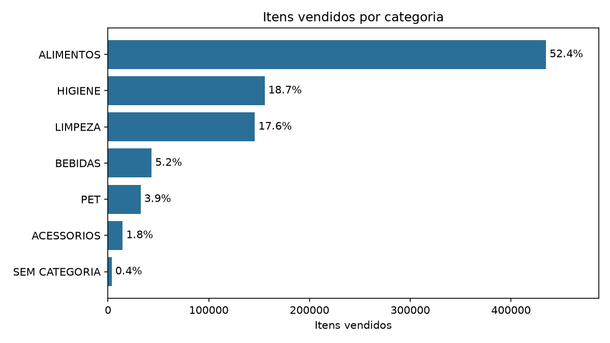
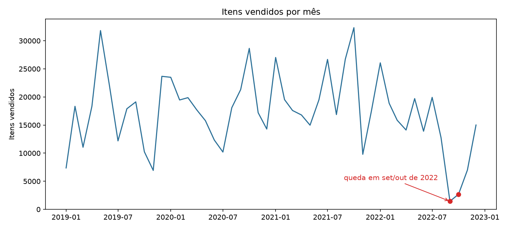
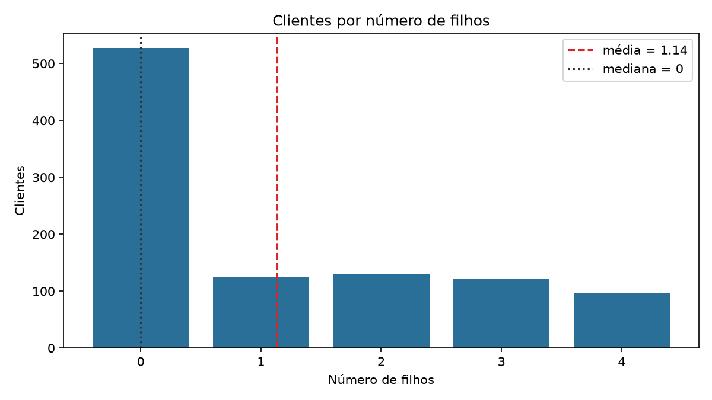

SC_Tech - Análise de Dados.

Trata-se de um projeto de aprendizado.

# Primeiro Passo:

    - Instalar o ambiente virtual Venv como : ".venv"

# Segundo Passo:

    - Fazer push do repositório
    https://github.com/Renato-V-Garcia/Miniprojeto_Renato_Garcia_Analise_de_Dados_T9.git

# Terceiro Passo:

    - Meu primeiro commit
        Realizei o primeiro commit com o inicio do projeto, este documento README_RenatoGarcia_T9.md o .gitignore e o que foi pedido que esta no arquivo Mini_projeto.md
    
# Quarto Passo:
    - Instalar o requirements.txt - são as dependencias do projeto.

# Quinto Passo:

    - Iniciar a codificação e o tratamento de dados.

    - Leitura inicial do CSV e geração do primeiro dataframe com pandas.

# Sexto Passo:

    - Sprint 2: padronização de texto (espaços e maiúsculas com regex), validação dos inteiros e conversão da coluna DATA para datetime.

# Sétimo Passo:

    - Sprint 3: tratamento de nulos e duplicatas.
        - Nulos: a base usa "#N/D" no lugar de vazio. Os 3.650 registros sem categoria são todos do mesmo produto (PR_ID 107). Em vez de apagar, usei os rótulos "SEM CATEGORIA" e "PRODUTO NAO IDENTIFICADO", assim as vendas não se perdem.
        - Duplicatas: a base não tem coluna de quantidade. Testei se as linhas repetidas eram erro de carga e concluí que não: nenhuma nota aparece em dois blocos do arquivo e a repetição cresce com o tamanho da nota. Por isso criei a coluna "quantidade" (nº de linhas iguais) e mantive uma linha por item.
        - Resultado: 830.000 linhas viraram 733.447, e a soma de "quantidade" continua 830.000.
        - A base limpa é salva em dados/df_limpo.csv.

# Oitavo Passo:

    - Sprint 4: estatística descritiva do número de filhos (CL_FHL), calculada por cliente (1.000 clientes), porque o número de filhos é uma característica do cliente e não da compra.
        - Média 1,14 | mediana 0 | moda 0 | desvio padrão 1,41 | mínimo 0 | máximo 4 | Q1 0 | Q3 2.

# Nono Passo:

    - Sprint 5: agrupamentos com groupby e pivot_table (gênero, categoria, categoria x gênero, ano e número de filhos) e relatório final no terminal.

# Décimo Passo:

    - Gráficos com matplotlib (salvos em graficos/ ao rodar o script), para mostrar os principais achados.

# Como executar

    - Coloque o arquivo "Base Varejo.csv" na pasta base_dados/ (baixado do Kaggle).
    - Crie o ambiente virtual, instale as dependências e rode o script:

        python -m venv .venv
        .venv\Scripts\activate
        pip install -r requirements.txt
        python Miniprojeto_Renato_Garcia_T9.py

# Principais insights

    1. ALIMENTOS lidera com 52,4% dos itens vendidos, seguido de HIGIENE (18,7%) e LIMPEZA (17,6%).
    2. As mulheres compram um pouco mais (432.576 itens contra 397.424), mas o tamanho médio da compra é praticamente igual (45 itens).
    3. 53% dos clientes não têm filhos (moda e mediana = 0). A média de 1,14 é puxada por quem tem de 1 a 4 filhos. O número de filhos quase não muda o volume comprado por cliente.
    4. 2021 foi o ano de maior venda. Em setembro e outubro de 2022 as vendas despencam (1.442 e 2.684 itens), o que sugere falta de dados e não queda real.
    5. Problema remanescente: 0,4% dos itens continuam sem categoria (produto 107).
    6. A base não tem preço nem quantidade, então só é possível analisar volume de itens, nunca faturamento.

# Reflexão teórica: ETL e qualidade de dados

    - ETL significa Extrair, Transformar e Carregar. Aqui, extrair foi ler o CSV; transformar foi padronizar textos, converter tipos, tratar nulos e consolidar duplicatas; carregar foi gravar o df_limpo.csv, que fica pronto para análises ou dashboards.
    - Dado ruim leva a conclusão ruim. Se eu tivesse apagado as linhas repetidas sem investigar, teria jogado fora 96.553 itens vendidos e subestimado todas as contagens.
    - Qualidade de dados é decidir com critério: antes de remover ou preencher qualquer valor, testar a hipótese e registrar a escolha (por exemplo, "#N/D" virou um rótulo explícito, e não um valor inventado).
    - Nem tudo se resolve na limpeza. A queda de set/out de 2022 e a ausência de preço são limites da fonte e precisam ser informados junto com os resultados.

# Observação sobre os nulos

    - O enunciado cita "dimensões físicas", mas a base Varejo não possui colunas de peso, altura ou largura. Os únicos nulos encontrados foram categoria e nome do produto (escritos como "#N/D"), tratados na Sprint 3 com os rótulos "SEM CATEGORIA" e "PRODUTO NAO IDENTIFICADO" (escritos em maiúsculas por causa da padronização de texto da Sprint 2).
    - As demais colunas não têm nulos, e isso foi verificado com isna() e com a busca por "#N/D".
